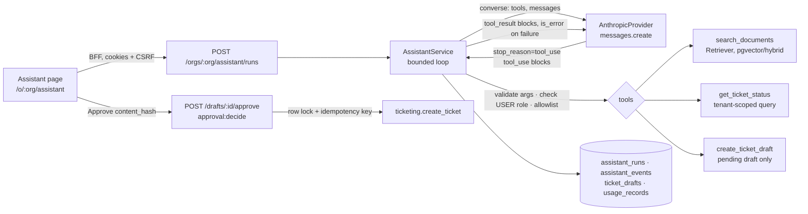

# Business assistant: architecture and runbook

A support assistant for **Harbor & Pine Home Services**, a fictional company (all content
is demo content). A signed-in staff member can:

1. ask a question and get an answer with **source references**;
2. check the status of an existing ticket;
3. have the assistant **prepare a ticket draft**, which a person must approve before a
   ticket exists.

The model picks tools through **Anthropic's native tool-use interface** (`tools` →
`tool_use` → `tool_result`), via the official Python SDK. Tool calls are never simulated
in prompt text.

## Architecture



| Piece | File |
|---|---|
| Provider adapter (`converse`: tools in, `tool_use` out, usage incl. cache categories) | `apps/api/src/solutionforge/llm/providers/claude.py` |
| Tool schemas, argument validation, permissions, safe summaries | `apps/api/src/solutionforge/assistant/tools.py` |
| Loop, limits, retries, telemetry, approval | `apps/api/src/solutionforge/assistant/service.py` |
| Citation parsing and validation | `apps/api/src/solutionforge/assistant/citations.py` |
| Fixture policy (rule-based stand-in, no key) | `apps/api/src/solutionforge/assistant/fixture.py` |
| Corpus loader, safe re-ingestion, demo setup | `apps/api/src/solutionforge/assistant/corpus.py` |
| Tables (migration `0011`) | `apps/api/src/solutionforge/domain/assistant.py` |
| API | `apps/api/src/solutionforge/api/v1/assistant.py` |
| UI | `apps/web/app/(app)/o/[org]/assistant/page.tsx` |

### The tools

| Tool | Input (validated by Pydantic; extra fields rejected) | Runs | Permission (the **user's** role) |
|---|---|---|---|
| `search_documents` | `query`: 2–300 chars, one line | `Retriever.search` on the chosen knowledge base, top-k passages | `knowledge:read` |
| `get_ticket_status` | `ticket_id`: `^T-[0-9A-F]{8}$` | Ticket lookup scoped to the organization | `workflow:execute` |
| `create_ticket_draft` | `subject` (3–200, one line), `description` (10–5000) | Inserts a **pending** draft. Never a ticket | `workflow:execute` |

There is no approve tool. Nothing the model can call creates a ticket.

- **Unknown tool names and invalid arguments** go back to the model as `tool_result`
  blocks with `is_error: true`. The message explains how to fix the call (for example
  `ticket_id: must look like T-1A2B3C4D`).
- **Permission failures** are returned the same way.
- **Retrieved passages** go back inside `tool_result` as JSON data. The system prompt says
  they are reference data, not instructions.
- **Display.** The UI and the event log show the tool name, a safe argument summary and
  the outcome. Queries are truncated and secret-looking strings redacted; for drafts, only
  the description length is shown. Private reasoning and raw prompts are never shown.

### The loop and its limits

Every run ends in a named state, stored on `assistant_runs.status`:

| Status | Meaning |
|---|---|
| `completed` | Final answer with ≥1 verified citation, or a ticket lookup or draft was made |
| `insufficient_evidence` | Final answer with no verified source. The UI says so |
| `limit_reached` | Turn limit, tool-call limit, deadline, per-run budget, or `max_tokens` |
| `cancelled` | `POST /runs/:id/cancel`, checked before every model call |
| `failed` | Non-transient provider error, refusal, transient errors past the retry budget, or an internal error |

| Limit | Setting (default) |
|---|---|
| Model calls per run | `SF_ASSISTANT_MAX_TURNS` (6) |
| Tool calls per run | `SF_ASSISTANT_MAX_TOOL_CALLS` (6) |
| Wall-clock deadline, enforced on provider calls and tools | `SF_ASSISTANT_DEADLINE_SECONDS` (60) |
| Per-request provider timeout | `SF_ASSISTANT_PROVIDER_TIMEOUT_SECONDS` (30) |
| Retries of transient errors (429, 5xx/529, timeouts), exponential backoff honouring `retry-after` | `SF_ASSISTANT_MAX_RETRIES` (2) |
| Estimated spend per run | `SF_ASSISTANT_RUN_BUDGET_USD` (0.05) |
| Drafts per run (identical calls are deduplicated) | 1 |

The SDK's own retries are disabled (`max_retries=0`), so every attempt is visible,
metered and counted.

### Approval

A draft's `content_hash` is the SHA-256 of its canonical subject and description.
`POST /drafts/:id/approve` takes `{content_hash}`:

- It needs **`approval:decide`** on the calling user. Viewers get 403. Another
  organization's draft gets 404.
- The draft row is locked (`SELECT … FOR UPDATE`), so concurrent approvals serialize.
- A hash that doesn't match the current draft gets **409**: the draft changed after review.
  Editing a draft (`PATCH`) changes the hash, so the reviewer has to look again.
- The ticket is created with the idempotency key `ticket-draft:<draft id>`. A double click,
  a retry or a concurrent approval returns the same ticket with `ticket_created: false`.
- Approved and rejected drafts are final. Every create, edit, approve and reject goes in
  the audit log.

Tests: `apps/api/tests/integration/test_assistant.py`, the "drafts & approval" and
"authorization" sections.

### Grounding

- **Citation format.** Answers cite `[DOC-ID#chunk]`, for example `[HP-POL-02#1]`.
- **Valid only if retrieved.** A citation counts only if that chunk was returned by
  `search_documents` **in the same run**. Others are removed from the answer and recorded
  as a `check` event.
- **Not proof of support.** Validity says nothing about whether the passage supports the
  answer. That is judged by a human, using `evals/assistant/GROUNDING_RUBRIC.md`.
- **Abstention.** With no evidence, the prompt tells the model to say so and offer a next
  step. The run is marked `insufficient_evidence`.
- **Prompt injection.** Retrieved text is untrusted. The five injection documents live
  only in a separate knowledge base used by the injection evals (`corpus/harbor-pine/injection/`).

### Retrieval configuration

Generation and embeddings are configured separately.

| | Value |
|---|---|
| Embedders | `hashing-v1`: lexical, offline, always available. Memory and container notes: [benchmarks §2b](ASSISTANT_BENCHMARKS.md). `bge-small-en-v1.5`: BAAI, MIT licence, via fastembed/ONNX, 384 dimensions, unit-normalised. Opt-in with `SF_SEMANTIC_EMBEDDER_ENABLED` |
| Storage | `vector(1024)` in pgvector. 384-dimension vectors are zero-padded, which preserves cosine similarity. The embedder is fixed per knowledge base, and queries use the same one |
| Metric | Cosine (HNSW index on PostgreSQL) |
| Chunking | Paragraph and sentence packing with exact character offsets. Default 800 characters, 120 overlap, set per knowledge base |
| Strategy | `SF_ASSISTANT_RETRIEVAL_STRATEGY`: `hybrid` (dense + keyword, reciprocal rank fusion; default), `dense`, or `keyword` |
| top-k | `SF_ASSISTANT_TOP_K` (4) |
| IDs | Document `doc_id` from the front matter; chunk ID = `doc_id#ordinal` |
| Authorization | Every search is scoped to the organization and knowledge base in SQL, before any content is returned |

Measured comparison: [`docs/ASSISTANT_BENCHMARKS.md`](ASSISTANT_BENCHMARKS.md).

### Telemetry

Each run records the following, with one ID linking the run, its events and its usage
records (`usage_records.step_id = assistant:<run id>`):

- the model ID, the full run configuration, the prompt version (`assistant-v1`) and the
  corpus version (a fingerprint of the knowledge base's documents);
- turns, tool calls and retries;
- tokens by category: input, output, cache reads, 5-minute and 1-hour cache writes. These
  are aggregated across **all** attempts, including failed ones;
- estimated cost: NULL means unknown, which is different from zero;
- end-to-end latency, retrieval latency, tool latency and the error.

Events: every provider call (attempt, stop reason, tokens, latency), every tool call
(name, safe arguments, outcome, result IDs, latency), citation checks and approvals.

Prices live in `apps/api/src/solutionforge/llm/pricing.py`: USD per million tokens, with
the source URL and access date. They include Haiku 5.5's >100k-token prompt tier and both
cache-write durations. They give **estimates**, not invoices. Override them with
`SF_LLM_PRICE_OVERRIDES`. A model with no price is refused, because its budget can't be
enforced.

## Runbook

### Setup (local, no Docker)

```bash
cd apps/api
python -m venv .venv && . .venv/bin/activate      # Windows: .venv\Scripts\activate
pip install -e ".[dev]"                            # add ".[dev,semantic]" for bge-small
cp ../../.env.example ../../.env                   # then edit; never commit .env
```

### Full stack (Docker)

```bash
cp .env.example .env
docker compose up --build --wait                   # runs migrations (0011 adds the assistant tables)
```

Open http://localhost:3000, sign up, create an organization, go to **Assistant** and click
**Load demo content**. That calls `POST /api/v1/orgs/{org}/assistant/demo-setup`, which is
idempotent. It loads the 20 core documents and 4 demo tickets: `T-1A2B3C4D` (open),
`T-5E6F7A8B` (in progress), `T-9C0D1E2F` (closed), `T-3D4E5F60` (waiting_customer).
The workers index the documents in the background.

Re-running demo setup is safe. Unchanged documents are skipped, and a changed document
replaces its previous version (same `doc_id`).

Without `SF_ANTHROPIC_API_KEY`, the only model offered is `fixture:policy-v1`, which the UI
labels as a rule-based test policy. With a key, `SF_ASSISTANT_MODEL` (default
`anthropic:claude-haiku-5-5`) is offered first.

### Tests

```bash
cd apps/api && pytest -n auto                                   # unit + integration (SQLite)
SF_TEST_DATABASE_URL=postgresql+asyncpg://… pytest -n auto      # same on PostgreSQL + pgvector
cd apps/web && npm run build && SF_PYTHON=python npx playwright test   # browser E2E
```

### Evals

Run these from `apps/api`. The full detail is in [evals/assistant/README.md](../evals/assistant/README.md).

```bash
python scripts/assistant_eval.py --dataset dev --models fixture:policy-v1          # harness check
python scripts/retrieval_eval.py --strategies hybrid,dense                          # retrieval comparison

# Live: needs SF_ANTHROPIC_API_KEY; caps are mandatory
python scripts/assistant_eval.py --dataset dev --models anthropic:claude-haiku-5-5 \
    --limit 3 --max-requests 15 --max-spend-usd 0.05                                # smoke
python scripts/assistant_eval.py --dataset dev \
    --models anthropic:claude-haiku-5-5,anthropic:claude-sonnet-5-5 \
    --max-requests 400 --max-spend-usd 2.00                                         # comparison
python scripts/assistant_eval.py --dataset dev --models anthropic:claude-haiku-5-5 \
    --tool-mode fixed --max-requests 200 --max-spend-usd 1.00                       # ReAct baseline arm
python scripts/assistant_eval.py --dataset holdout --models <chosen> --confirm-holdout \
    --max-requests 100 --max-spend-usd 0.50                                         # once, at the end
```

### Configuring the API key (never paste it into chat or commit it)

| Where the model runs | Set `SF_ANTHROPIC_API_KEY` here | Spend control |
|---|---|---|
| Deployed demo (Render) | Render dashboard → **solutionforge-api** → **Environment** → `SF_ANTHROPIC_API_KEY`, as a secret value. Then **Save, rebuild and deploy**. The browser never receives it | `SF_ASSISTANT_RUN_BUDGET_USD` (blueprint: 0.02 per run) |
| Local evals (`scripts/assistant_eval.py`) | `apps/api/.env` (git-ignored), line `SF_ANTHROPIC_API_KEY=…`, or a shell variable | Mandatory `--max-requests` and `--max-spend-usd` per invocation |

To check a local key without spending anything:

```bash
python scripts/check_anthropic_key.py anthropic:claude-haiku-5-5 anthropic:claude-sonnet-5-5
```

It calls only the Models API and never prints the key.

To check that the key is active on Render without exposing it, run
`scripts/assistant_smoke.py`. It prints the models offered; `anthropic:…` appears only
when a key is set.

### Post-deploy verification

```bash
python scripts/assistant_smoke.py https://solutionforge-api.onrender.com --timeout 120
```

It creates a labelled throwaway account and organization ("SMOKE TEST (assistant) - safe
to delete"), then checks:

- the configuration (models, limits, embedder);
- a sourced answer with its citations retrieved in that run;
- a ticket lookup;
- a draft that is not a ticket until approved;
- that explicit approval creates exactly one ticket;
- that repeat and concurrent approvals create nothing more;
- that a stale hash is refused after an edit;
- that an unsupported question abstains.

Afterwards it deletes the demo knowledge base. Users, organizations, tickets, drafts and
runs have no delete API, and audit rows are append-only, so those remain, labelled. The
default model is the free fixture; `--model anthropic:…` makes paid calls.

### Deployment

`render.yaml` takes `SF_ANTHROPIC_API_KEY` as a prompted, server-side secret (`sync:
false`). It is never sent to the browser, and the BFF only forwards to the API.

- **Logs** are structured JSON. The assistant logs run IDs and exception types, never
  prompts, answers or keys.
- **Settings errors** never echo values (`hide_input_in_errors`).
- **Per-run spend** is capped by `SF_ASSISTANT_RUN_BUDGET_USD`, set to 0.02 in the blueprint.
- **Embedder.** The deployed demo keeps the lexical embedder: the semantic model's memory
  use on the 512 MB free plan has not been measured.

## Known limitations

- **No live model results.** Live evaluation needs an Anthropic API key, and none was
  available. The model comparison and the ReAct experiment are **BLOCKED**, not run.
- **The fixture policy is not a model.** It shows the harness, scoring and approval flow
  work. Its pass rates say nothing about model quality.
- **Small datasets.** 30 dev and 10 held-out cases, and 12 retrieval questions. One case
  is 3–8 percentage points.
- **Runs are synchronous.** A run executes inside the HTTP request (bounded by the
  deadline). A queue-backed run, with streaming progress, is the next step for longer tasks.
- **Run-level cancellation** takes effect between steps, not in the middle of a provider
  call. The code records `cancelled` if the request task itself is cancelled, but that
  path (a client disconnect) has no test.
